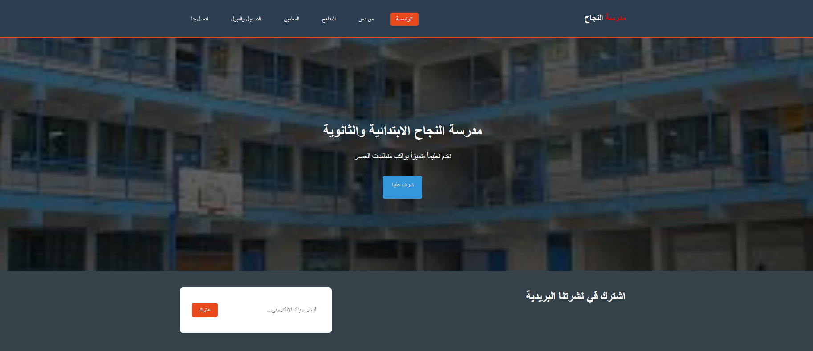
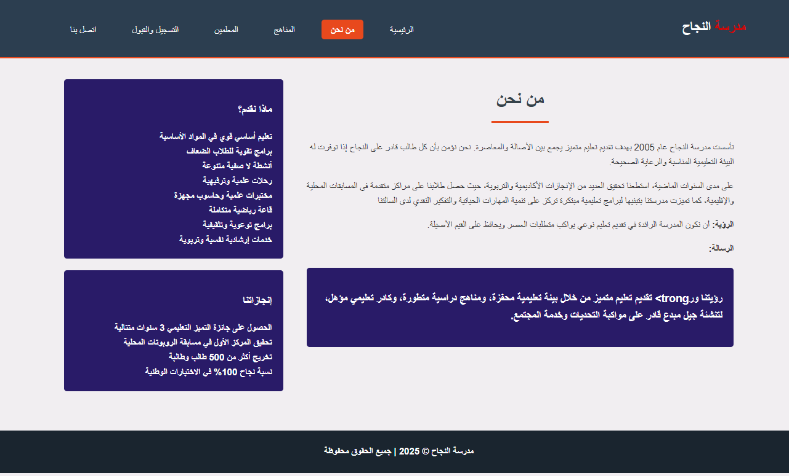
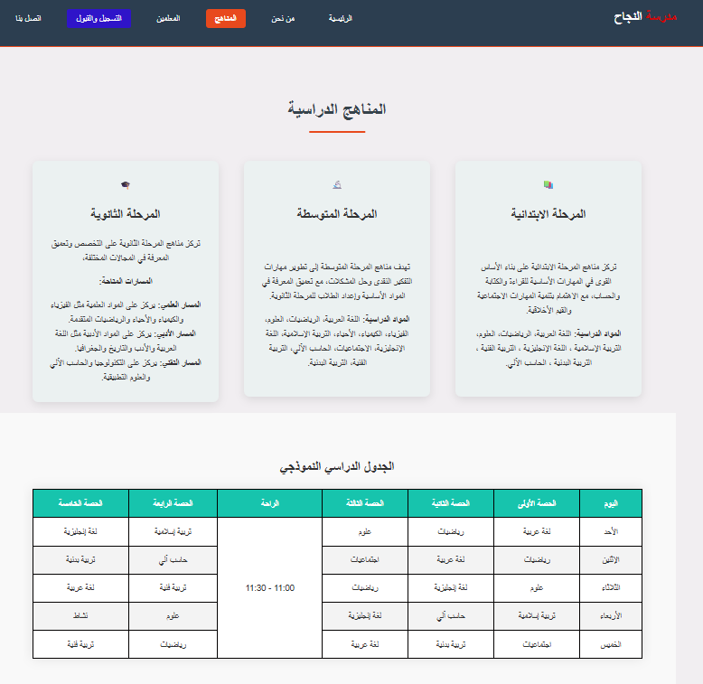
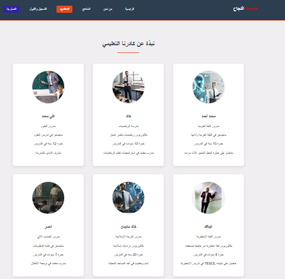
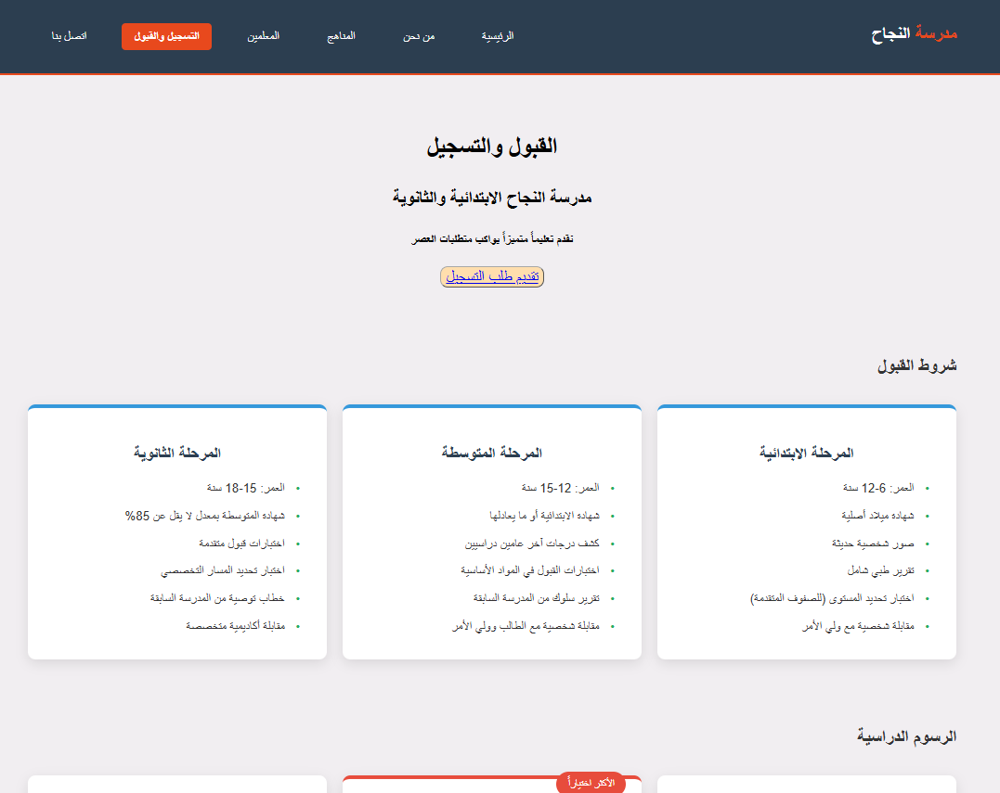
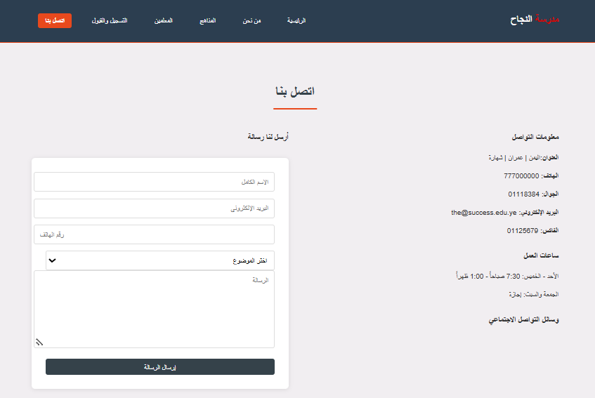

# موقع مدرسة النجاح الابتدائية والثانوية

موقع ويب تعريفي وتفاعلي لـ مدرسة النجاح الابتدائية والثانوية يعرض هوية المدرسة، مراحلها الدراسية، كادرها التعليمي، شروط التسجيل والرسوم، وطرق التواصل المباشر مع الإدارة.

## أبرز أقسام ومميزات الموقع
- الصفحة الرئيسية: واجهة ترحيبية تبرز هوية المدرسة مع زر للتعريف بها، ونشرة بريدية، وبطاقات المزايا (فصول حديثة، معلمون متميزون، أنشطة متنوعة)، ومعرض صور للأنشطة والرحلات المدرسية.
- من نحن: عرض نبذة عن نشأة المدرسة وأهدافها، الرؤية والرسالة، قائمة الخدمات المقدمة، وأبرز الإنجازات الأكاديمية والطلابية.
- المناهج الدراسية: استعراض المراحل الدراسية (الابتدائية، المتوسطة، الثانوية) مع المسارات والمواد الدراسية، وجدول دراسي نموذجي، وقسم الأنشطة اللاصفية.
- المعلمين: دليل تعريفي بالكادر التعليمي يوضح التخصص، المؤهل، سنوات الخبرة، والخبرات الإضافية لكل معلم.
- التسجيل والقبول: توضيح شروط القبول لكل مرحلة، جدول الرسوم الدراسية، ونموذج إلكتروني لتقديم طلب التسجيل.
- اتصل بنا: نموذج لإرسال الرسائل المباشرة، بيانات التواصل وساعات العمل، روابط المنصات، وقسم الأسئلة الشائعة.

## لقطات من الموقع

### 1. الصفحة الرئيسية
الواجهة الأولى للموقع وتضم التعريف بالمدرسة، الاشتراك في النشرة البريدية، مزايا المدرسة، ومعرض الصور.

### 2. من نحن
تعرض قصة المدرسة، الرؤية والرسالة، الخدمات والأنشطة، والإنجازات المحققة.

### 3. المناهج الدراسية
توضح تفاصيل المراحل الدراسية والمسارات المتاحة مع الجدول الدراسي النموذجي والأنشطة اللاصفية.

### 4. المعلمين
تستعرض بطاقات أعضاء هيئة التدريس وتخصصاتهم وخبراتهم التعليمية.

### 5. التسجيل والقبول
تضم شروط الالتحاق، الرسوم الدراسية حسب المرحلة، ونموذج التسجيل للطلاب الجدد.

### 6. اتصل بنا
تحتوي على نموذج المراسلة، معلومات الاتصال وساعات العمل، والأسئلة الشائعة.

## هيكل ملفات المشروع
- ملفات الصفحات (`HTML`) لتوزيع أقسام الموقع.
- ملفات التنسيق (`CSS`) لتنسيق الواجهات والألوان والخطوط.
- صور واجهات ولقطات المشروع (`PNG`).
